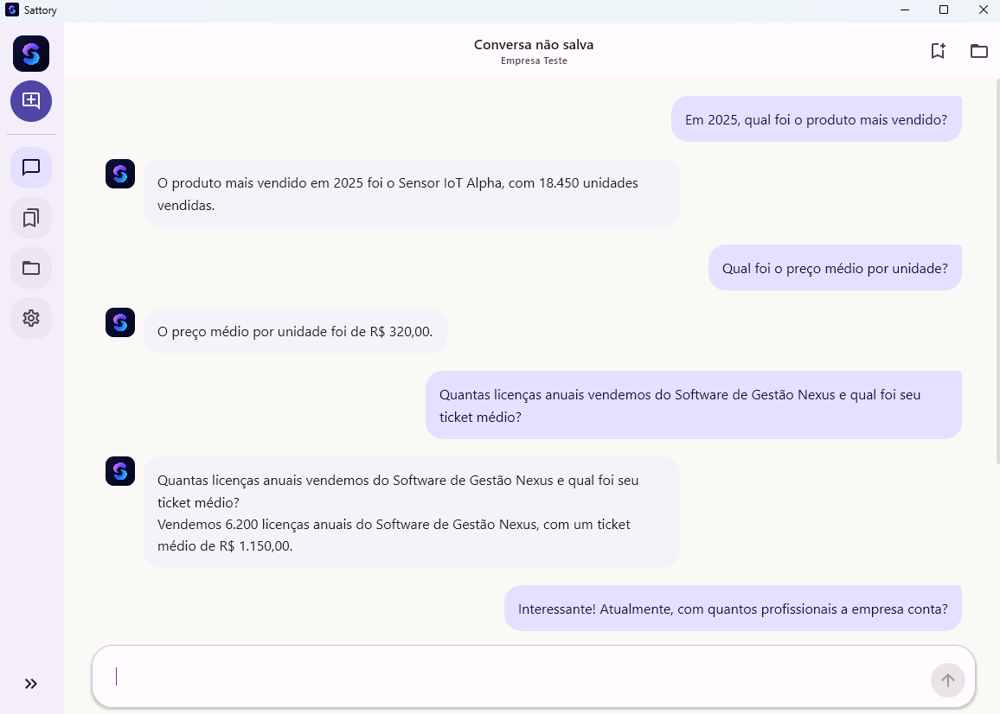
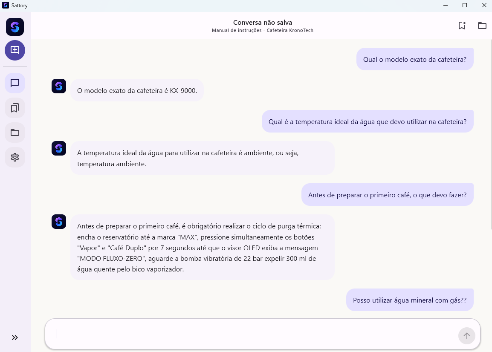

# Sattory AI

O Sattory AI é um assistente de documentos para Android e desktop que ajuda a consultar informações em textos longos usando inteligência artificial executada localmente. Depois que os modelos necessários são baixados, o processamento e as consultas acontecem no próprio dispositivo, sem depender de uma conexão com a internet.

O aplicativo usa **RAG** (Retrieval-Augmented Generation/Geração aumentada por recuperação) para fundamentar as respostas no conteúdo dos documentos: primeiro localiza os trechos mais relacionados à pergunta, em seguida envia esses trechos ao modelo de linguagem local.

## Funcionalidades

**Converse com uma IA local**

- Faça perguntas em linguagem natural e receba respostas geradas no próprio dispositivo.
- Continue uma conversa com histórico ou comece uma nova conversa para reiniciar o contexto.
- Salve, consulte ou exclua conversas armazenadas localmente.

**Consulte documentos com RAG**



- Crie coleções de documentos e faça perguntas sobre o conteúdo reunido nelas.
- Importe PDFs com texto selecionável; o texto extraído é dividido em trechos e indexado para recuperação.
- Combine busca por palavras (BM25) e similaridade semântica por embeddings multilíngues para encontrar passagens relevantes.
- Veja as fontes incluídas na resposta, identificadas pelo documento e pela posição do trecho.
- Receba uma resposta baseada nas fontes selecionadas. O conteúdo do documento é tratado como material de consulta, não como instrução para o modelo.
- PDFs digitalizados como imagem não passam por OCR e precisam ter o texto reconhecido previamente.



**Use em diferentes dispositivos**

- Interface adaptável para celulares Android e telas maiores no desktop.
- No Android, os modelos são baixados sob demanda, verificados por SHA-256 e mantidos no armazenamento do aplicativo; o arquivo de linguagem não é incluído no APK.
- No desktop, use o modelo GGUF padrão do projeto ou informe o caminho de outro arquivo compatível.

## Modelos locais

| Uso | Modelo configurado | Formato |
| --- | --- | --- |
| Geração de respostas | Qwen3 1.7B Q4_K_M (aproximadamente 1,2 GB) | GGUF quantizado |
| Embeddings para busca semântica | Multilingual E5 Small | GGUF quantizado Q8_0 |

Os modelos são artefatos separados do código-fonte e são obtidos quando necessários. O primeiro download requer internet; depois que os arquivos estão disponíveis, as inferências e consultas podem ser realizadas offline. No desktop, o caminho padrão do modelo de linguagem é `local-models/qwen/qwen3-1.7b-q4_k_m.gguf`.

## Stack utilizada neste projeto

| Área | Tecnologias |
| --- | --- |
| Linguagem | Kotlin 2.4.0 — linguagem principal, com código compartilhado entre Android e desktop. |
| Multiplataforma | Kotlin Multiplatform — módulos comuns e implementações específicas para Android e JVM. |
| Interface | Compose Multiplatform 1.11.1 e Material 3 1.11.0-alpha07 — interface declarativa adaptável às plataformas. |
| Aplicativo Android | Android Gradle Plugin 9.0.1; compileSdk e targetSdk 36; versão mínima Android 7.0 (API 24). |
| Aplicativo desktop | Compose Desktop para JVM — distribuição configurada para Windows (EXE/MSI), macOS (DMG) e Linux (DEB). |
| Build | Gradle Wrapper 9.1.0 e Kotlin Symbol Processing (KSP) 2.3.9. |
| Alvo Java/Kotlin | Bytecode JVM 11 para os módulos Android. |
| Inferência local | llama.cpp, integrado por uma ponte nativa em C++/JNI; modelos locais em formato GGUF. |
| Busca semântica | Multilingual E5 Small — embeddings multilíngues para relacionar perguntas e trechos de documentos. |
| Recuperação RAG | BM25, rank fusion estável, filtragem por relevância e remoção de sobreposição entre trechos. |
| PDF | PDFBox Android 2.0.27.0 no Android e Apache PDFBox 3.0.7 no desktop. |
| Persistência | Room 2.8.4 e SQLite bundled 2.6.1 para dados locais, coleções e conversas salvas. |
| Injeção de dependências | Koin 4.1.1. |
| Concorrência | Kotlin Coroutines 1.11.0 e Flow para tarefas assíncronas e geração em fluxo. |
| Tarefas Android | WorkManager 2.11.2 para download dos modelos em segundo plano. |
| Android nativo | NDK 29.0.13113456 e CMake 3.31.0; bibliotecas configuradas para `arm64-v8a` e `x86_64`. |
| Testes | Kotlin Test, JUnit 4.13.2 e kotlinx-coroutines-test 1.11.0. |

As versões listadas correspondem à configuração do projeto neste repositório. A interface, a lógica de conversa, a recuperação RAG e o acesso a dados são compartilhados sempre que possível; leitura de PDFs e integração nativa com os modelos têm implementações específicas para cada plataforma.

## Executar o projeto

É necessário ter um JDK compatível com Gradle 9.1.0 e, para compilar ou executar o app Android, o Android SDK e o NDK configurados no ambiente.

Inicialize o submódulo nativo após clonar o repositório:

```shell
git submodule update --init --recursive
```

Na raiz do projeto, use os comandos do Gradle Wrapper abaixo. No Windows, substitua `./gradlew` por `./gradlew.bat`.

**Android**

```shell
./gradlew :androidApp:assembleDebug
```

**Desktop**

```shell
./gradlew :desktopApp:run
```

**Testes**

```shell
# Testes compartilhados para Android (JVM host)
./gradlew :shared:testAndroidHostTest

# Testes compartilhados no desktop
./gradlew :shared:jvmTest
```
